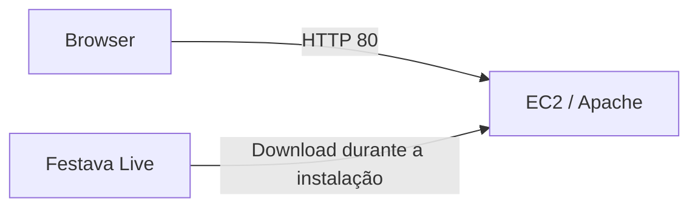

# Alojar um website estático numa instância EC2

Guia de laboratório para servir os ficheiros de [Festava Live](https://github.com/edgarjose/festava_live) com Apache. A infraestrutura é criada manualmente; este repositório contém o procedimento, não templates de infraestrutura.

## Arquitetura



## Pré-requisitos

- Conta de laboratório AWS e uma instância Amazon Linux 2023 com acesso de saída à internet.
- Sub-rede pública com rota para um Internet Gateway e um endereço público associado à instância, se o teste for feito pela internet.
- Acesso administrativo por Session Manager ou SSH restrito ao teu IP.
- Security group com TCP 80 permitido apenas para a origem necessária ao teste.

Não é necessário instalar PHP ou uma base de dados: o conteúdo é estático.

## Instalar o Apache

Na instância, executar:

```bash
sudo dnf install -y httpd curl unzip
sudo systemctl enable --now httpd
```

## Publicar o website

Usar um diretório temporário, sem alterar a propriedade de todo o diretório do Apache:

```bash
LAB_DIR="$(mktemp -d)"
curl -fsSL https://github.com/edgarjose/festava_live/archive/refs/heads/main.zip -o "$LAB_DIR/site.zip"
unzip -q "$LAB_DIR/site.zip" -d "$LAB_DIR"
sudo cp -a "$LAB_DIR/festava_live-main/." /var/www/html/
sudo find /var/www/html -type d -exec chmod 755 {} +
sudo find /var/www/html -type f -exec chmod 644 {} +
```

O diretório temporário pode ser removido depois de confirmares o resultado. A branch `main` é mutável; fixa uma revisão para um ensaio que precise de conteúdo idêntico.

## Verificar

```bash
sudo systemctl is-active httpd
curl -I http://127.0.0.1/
```

Esperar o serviço ativo e uma resposta HTTP 200. No teu computador, abrir `http://IP_PUBLICO/`. Se funcionar localmente mas não externamente, verificar endereço público, rota e security group.

## Limitações e limpeza

O laboratório usa HTTP. Para publicação real, configurar HTTPS, atualizações e observabilidade ou escolher um serviço de alojamento adequado. Os formulários do template não têm backend.

EC2, armazenamento e endereços IPv4 públicos podem gerar custos. No fim, terminar a instância, verificar os volumes EBS e libertar um Elastic IP dedicado, caso tenha sido criado. Não eliminar recursos partilhados.

[Conteúdo do website](https://github.com/edgarjose/festava_live) · [Variante com Docker](https://github.com/edgarjose/ecr-ecs-docker-website-project)
